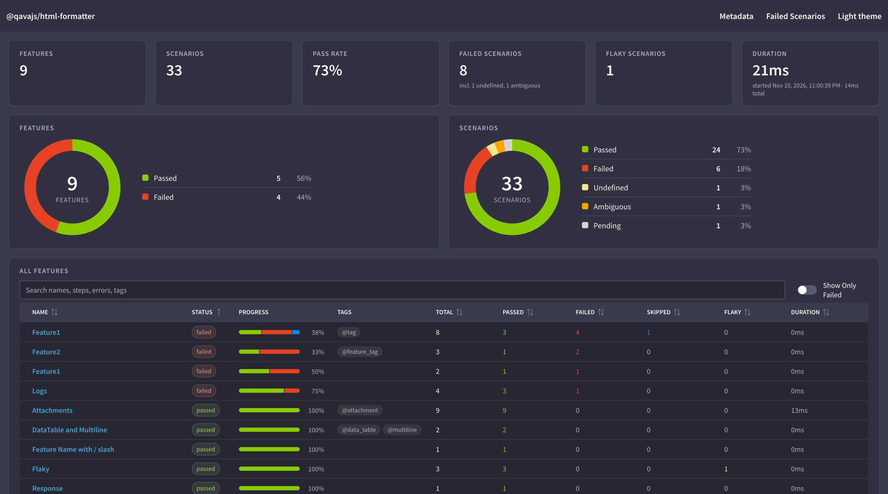

# @qavajs/html-formatter

Single file HTML formatter for cucumber framework

### Installation
To install formatter run

```
npm install @qavajs/html-formatter
```

and add to formatter section in config file

```typescript
export default {
    format: [
        ['@qavajs/html-formatter', 'report.html']
    ],
    formatOptions: {
        htmlConfig: {
            showLogs: true, // enable/disable text/x.cucumber.log+plain
            metadata: {
                'OS': 'macos',
                'OS Version': '13.1'
            },
            attachments: 'inline', // 'inline' (default) | 'external'
            attachmentsDir: 'attachments' // used with attachments: 'external'
        }
    },
}
```

or pass `--format @qavajs/html-formatter:report.html` in cli



### Options

| Option           | Default         | Description                                                                                                                         |
|------------------|-----------------|-------------------------------------------------------------------------------------------------------------------------------------|
| `showLogs`       | `true`          | Include `text/x.cucumber.log+plain` attachments (logs)                                                                              |
| `metadata`       | `{}`            | Key-value pairs shown in the Metadata dialog                                                                                        |
| `attachments`    | `'inline'`      | `'inline'` - everything is embedded into the single html file. `'external'` - binary attachments (screenshots, videos, archives...) are written to `attachmentsDir` next to the report, which keeps big reports small |
| `attachmentsDir` | `'attachments'` | Directory for external attachments, relative to the report file (or absolute)                                                       |

With `attachments: 'external'`:
- text attachments (logs, responses, json, html, text) always stay inline - their content is rendered in the report, and browsers do not let a local file read other local files;
- files are named by content hash, so identical screenshots are stored once. The directory is not cleaned between runs;
- keep the directory next to the report when copying or publishing it (e.g. as a CI artifact); a missing file is reported in the attachment dialog;
- the report must be written to a file (not stdout), otherwise attachments are inlined with a warning.

### Report

- **Overview** - pass rate, failed (incl. undefined / ambiguous) and flaky scenario counts, wall clock duration (correct for parallel runs) with the run start time and summed scenario duration, feature and scenario status charts, features table (failed features first).
- **Feature page** - scenarios with gherkin keywords (Given / When / Then, Before / After hooks), Scenario Outline example values, step arguments, attachments, errors. Passed Before / After hooks are hidden by default.
- **Failed scenarios** - all failed scenarios, expanded, optionally grouped by error (similar messages with different numbers fall into one group).
- **Retries** - with cucumber `retry`, a scenario that passed after a retry is marked `flaky`, retried scenarios show their previous attempts (failed step and error).
- **Search** covers scenario names, step text, error messages, tags and example values. Clicking a tag filters by it.
- **Links** - every filter is kept in the url, so a filtered view can be shared. The link icon on a scenario copies a link that opens it expanded.
- **Light / dark theme** toggle in the header (remembered in the browser); printing always uses the light theme.

Url parameters (after `#/...?`):

| Parameter       | Pages                 | Description                                                  |
|-----------------|-----------------------|--------------------------------------------------------------|
| `q`             | all                   | Search text                                                  |
| `tag`           | all                   | Tag filter, e.g. `tag=%40smoke`                              |
| `failed=true`   | overview, feature     | Show only failed                                             |
| `hooks=true`    | feature, failed       | Show passed Before / After hooks                             |
| `group=error`   | failed                | Group failed scenarios by error                              |
| `scenario=<id>` | feature               | Expand, highlight and scroll to the scenario                 |

Feature page urls are derived from the feature file path (`#/feature/features-auth-Login` for `features/auth/Login.feature`), so they stay the same between runs.

## Development

```
npm install
```

| Command                   | Description                                                                                                                                                       |
|---------------------------|-------------------------------------------------------------------------------------------------------------------------------------------------------------------|
| `npm start`               | Dev server with sample report data on http://localhost:3000. Data is generated on first start; run `npm run report:data` in another terminal to refresh it - the page reloads automatically. |
| `npm run report:data`     | Runs sample features (`test/features`) and writes report data to `test/report/report.json`                                                                        |
| `npm run report:generate` | Builds formatter template and generates sample report `test/report/report.html` with the real formatter                                                            |
| `npm run build`           | Builds formatter template `formatter/index.html`                                                                                                                  |
| `npm test`                | Unit tests                                                                                                                                                        |
| `npm run lint`            | Lint                                                                                                                                                              |
| `npm run typecheck`       | Type check                                                                                                                                                        |

Sample report config (metadata, `showLogs`) lives in `test/report.ts` and is used both by the dev server and by `report:generate`.
`npx qavajs run --config test/report.ts --profile external --no-error-exit` generates `test/report/external/report.html` with external attachments.
